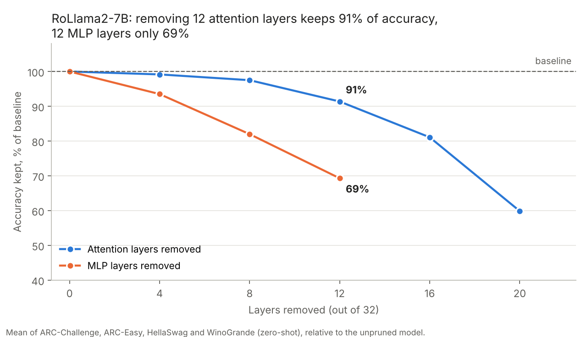
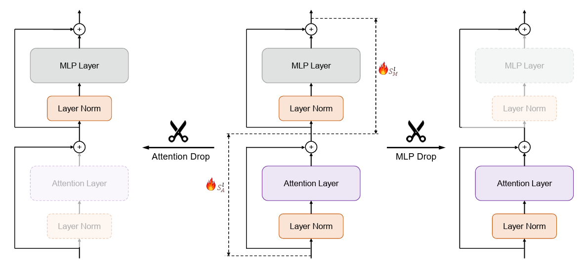
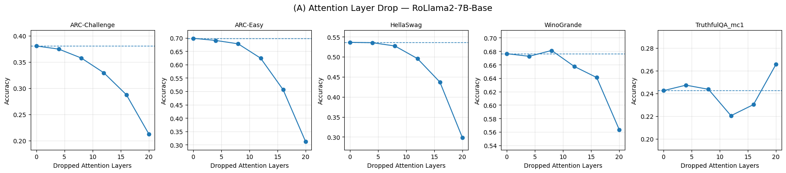
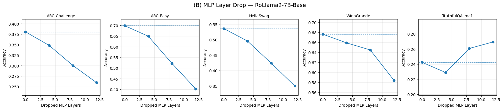
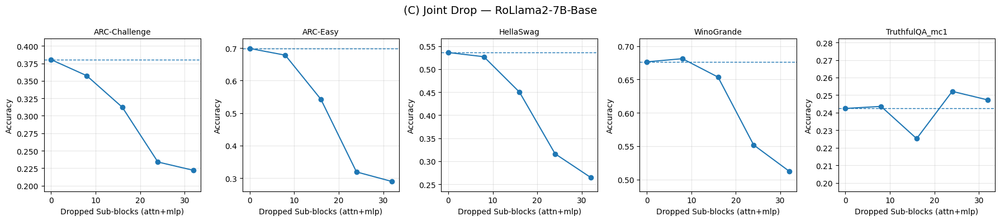

# How Redundant Are Transformer Layers? Attention vs. MLP Ablations on RoLlama2-7B

Research project for the LLMs and Cognition course (MSc Data Science, Year I, Semester I, University of Bucharest)

This research builds on [*What Matters in Transformers? Not All Attention Is Needed*](https://arxiv.org/abs/2406.15786) (He et al., 2024). That paper shows that many attention layers in large English LLMs can be removed with little loss in performance. **We tested whether this still holds for other model sizes, languages and architectures:** a Romanian 7B model, a 1.1B model and an encoder–decoder translation model.

This README describes only my contribution to this research: the experiments on **RoLlama2-7B**, a Romanian-adapted LLaMA-2 with 32 decoder layers. The full team report and presentation are in [`docs/`](docs/).

## Research question

Are attention layers more redundant than MLP layers in a **Romanian-adapted** LLM, as they are in English models?

## Method

1. **Calibration.** I ran 256 Romanian Wikipedia segments (up to 2,048 tokens each) through the model, with no training. For every attention and MLP sub-layer, its importance score is **1 − cosine similarity** between the sub-layer's input and output. A layer that barely changes its input counts as redundant.
2. **Structured ablation.** I removed the least important sub-layers by zeroing their projection weights. The residual connection keeps information flowing through the network. The first and last layers were always kept.

   
   *Figure adapted from He et al. (2024).*

   - **Attention Drop:** 4, 8, 12, 16 and 20 attention layers removed
   - **MLP Drop:** 4, 8 and 12 MLP layers removed
   - **Joint Drop:** attention and MLP layers removed together, up to 32 sub-layers
3. **Evaluation.** Zero-shot evaluation with `lm-eval-harness` on ARC-Easy, ARC-Challenge, HellaSwag and WinoGrande. The model runs in float16, inference only, on an NVIDIA GB10 GPU with 128 GB.

## Results

| Removed | ARC-C | ARC-E | HellaSwag | WinoGrande |
|---|---|---|---|---|
| None (baseline) | 0.381 | 0.699 | 0.536 | 0.676 |
| 8 attention | 0.358 | 0.678 | 0.527 | 0.681 |
| 12 attention | 0.329 | 0.624 | 0.496 | 0.658 |
| 12 MLP | 0.259 | 0.402 | 0.350 | 0.584 |
| 24 joint | 0.234 | 0.319 | 0.316 | 0.552 |

- **Attention layers are highly redundant.** With 8 of 32 attention layers removed (25%), the model keeps about 97% of its accuracy. With 12 removed (37.5%), it keeps about 91%.
- **MLP layers are not.** Removing the same 12 layers from the MLPs leaves only about 69% of the accuracy.
- **Multi-step reasoning breaks first.** ARC-Challenge drops earliest, while HellaSwag and WinoGrande hold up longer.
- **Joint Drop compresses more**, but accuracy collapses after about 16 removed sub-layers.

These results reproduce the original paper's finding on a Romanian model.

Per-benchmark plots

## Team & credits

This repository covers only my part of the study. The other experiments in the team report are the work of my colleagues:

| Author | Contribution |
|---|---|
| [Laura-Vanesa Lungu](https://github.com/LVanesa) | RoLlama2-7B: calibration, attention / MLP / joint ablations, evaluation and analysis (this repository) |
| [Oana-Maria Cochiorca](https://github.com/oanamaria10) | TinyLlama-1.1B: ablations, stability of importance scores across 4 calibration corpora, perplexity |
| [Raluca-Marina Negoiță-Crețu](https://github.com/ncraluca) | mT5-small: encoder–decoder ablations on WMT16 Ro-En, with and without recovery fine-tuning |
